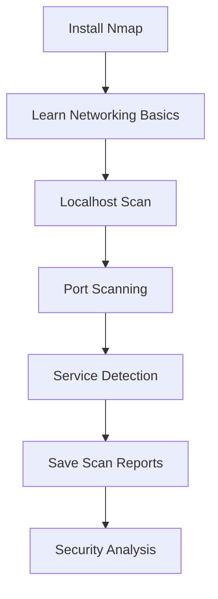

# Network Scanning: Beginner to Practical

A beginner-friendly Nmap course for learning safe network scanning using localhost only.

## Safety Rule

Scan only your own computer:

```bash
nmap 127.0.0.1
```

Do not scan public websites, college networks, office systems, or other people’s devices without written permission.

## Course Contents

- [Complete Nmap Syllabus](syllabus.md)
- [Nmap Practical Lab](practical/nmap-practical.md)
- [Screenshot Guide](screenshots/README.md)

## Quick Start

Install Nmap, then verify:

```bash
nmap --version
```

Run your first safe scan:

```bash
nmap 127.0.0.1
```

## Learning Path



# Complete Nmap Syllabus

## Level 1 — Beginner

### 1. Introduction to Nmap
- What is Nmap?
- Why network scanning is used
- Ethical and legal rules
- Authorized vs unauthorized scanning
- Common Nmap use cases

### 2. Networking Basics
- IP address
- Localhost: `127.0.0.1`
- Private vs public IP
- Ports and services
- TCP vs UDP
- Open, closed, and filtered ports

### 3. Installing Nmap
- Windows installation
- Linux installation
- macOS installation
- Verify installation:

```bash
nmap --version
```

### 4. Basic Scanning
- Scan localhost:

```bash
nmap 127.0.0.1
```

- Scan a single IP
- Scan multiple IPs
- Scan an IP range
- Scan a subnet
- Read basic Nmap output

## Level 2 — Practical Scanning

### 5. Host Discovery
- Ping scan:

```bash
nmap -sn 127.0.0.1
```

- Disable ping scan:

```bash
nmap -Pn 127.0.0.1
```

### 6. Port Scanning
- Scan one port:

```bash
nmap -p 80 127.0.0.1
```

- Scan multiple ports:

```bash
nmap -p 80,443 127.0.0.1
```

- Scan a range:

```bash
nmap -p 1-100 127.0.0.1
```

- Scan all ports:

```bash
nmap -p- 127.0.0.1
```

- Fast scan:

```bash
nmap -F 127.0.0.1
```

### 7. Scan Types
- TCP connect scan:

```bash
nmap -sT 127.0.0.1
```

- SYN scan:

```bash
nmap -sS 127.0.0.1
```

- UDP scan:

```bash
nmap -sU 127.0.0.1
```

## Level 3 — Detection

### 8. Service Detection

```bash
nmap -sV 127.0.0.1
```

### 9. Operating System Detection

```bash
nmap -O 127.0.0.1
```

### 10. Aggressive Scan

```bash
nmap -A 127.0.0.1
```

## Level 4 — Nmap Scripting Engine

### 11. NSE Scripts
- Default scripts:

```bash
nmap -sC 127.0.0.1
```

- Run script category:

```bash
nmap --script default 127.0.0.1
```

### 12. Script Categories
- `auth`
- `broadcast`
- `default`
- `discovery`
- `safe`
- `version`
- `vuln`

**Warning:** Do not run intrusive or vulnerability scripts without authorization.

## Level 5 — Output and Performance

### 13. Firewall Awareness
- What is a firewall?
- Why ports appear as `filtered`
- Scan alerts and permissions

### 14. Timing

```bash
nmap -T4 127.0.0.1
```

### 15. Save Results
- Normal output:

```bash
nmap -oN scan.txt 127.0.0.1
```

- XML output:

```bash
nmap -oX scan.xml 127.0.0.1
```

- All formats:

```bash
nmap -oA scan 127.0.0.1
```

## Level 6 — Advanced

### 16. Nmap Configuration
- Verbose output:

```bash
nmap -v 127.0.0.1
```

- Show scan reasons:

```bash
nmap --reason 127.0.0.1
```

### 17. Zenmap
- Graphical Nmap interface
- Scan profiles
- Visual results

### 18. Reporting
- Scan scope
- Authorization
- Findings
- Recommendations

## Level 7 — Security

### 19. Vulnerability Basics
- Open port vs vulnerability
- Version detection limitations
- Safe next steps

### 20. Responsible Disclosure
- Report only to authorized owners
- Do not exploit systems
- Keep findings private

### 21. Practice Labs
- Localhost scanning
- Virtual machine lab
- Isolated security lab
- CTF platforms
## Official Resources

- [Nmap Reference Guide](https://nmap.org/book/man.html)
- [Nmap Download Page](https://nmap.org/download.html)
- [Wireshark Documentation](https://www.wireshark.org/docs/)
