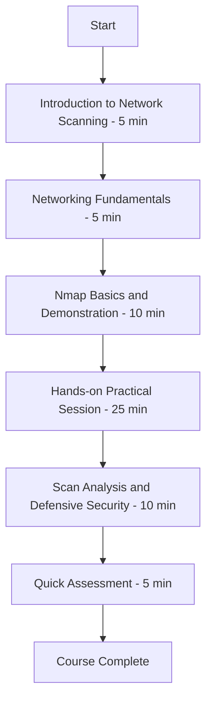

# Network Scanning Practical Course

A focused, hands-on **Scanning course** using **Nmap**, with an optional introduction to **Wireshark** for packet analysis.

This course is designed for cybersecurity beginners, students, IT support learners, and anyone building a practical cybersecurity portfolio. It teaches how to safely discover hosts, identify open ports, detect services, save scan results, analyze findings, and recommend basic defensive improvements.

> **Safety notice:** Use this course only on `localhost`, your own computer, virtual machines you own, or an isolated lab where you have explicit authorization. Do not scan public websites, third-party systems, corporate networks, or other people’s devices without written permission.

## Course Workflow

## What You Will Learn

By the end of this course, you will be able to:

- Explain what network scanning is and why it is used in cybersecurity.
- Understand IP addresses, TCP, UDP, ports, and common services.
- Differentiate between host discovery and port scanning.
- Install and verify Nmap on Windows, Linux, or macOS.
- Perform safe localhost scans using Nmap.
- Identify open, closed, and filtered port states.
- Detect services and versions on open ports.
- Save scan results in normal text and XML formats.
- Analyze scan output and identify unnecessary exposed services.
- Document findings in a professional scan report.
- Apply basic defensive security recommendations.

## Practical Progress Checklist

- [ ] Read the safety and authorization rules
- [ ] Install Nmap
- [ ] Verify Nmap installation
- [ ] Identify your local IP address
- [ ] Perform a localhost scan
- [ ] Identify open, closed, and filtered ports where available
- [ ] Detect services and versions
- [ ] Start a safe local test service
- [ ] Scan the local test service
- [ ] Save results in normal and XML formats
- [ ] Analyze scan results
- [ ] Complete the sample scan report
- [ ] Finish the final assessment

## Tools Used

- **Nmap** — Primary network scanning tool.
- **Wireshark** — Optional packet-analysis tool.
- **Terminal / Command Prompt / PowerShell** — For running commands.
- **VirtualBox or Docker** — Optional, for an isolated two-machine lab.

## Official Documentation

- [Nmap Reference Guide](https://nmap.org/book/man.html)
- [Nmap Documentation](https://nmap.org/docs.html)
- [Wireshark Documentation](https://www.wireshark.org/docs/)
- [Wireshark User’s Guide](https://www.wireshark.org/docs/wsug_html_chunked/)

## License

This repository is released under the [MIT License](LICENSE).
